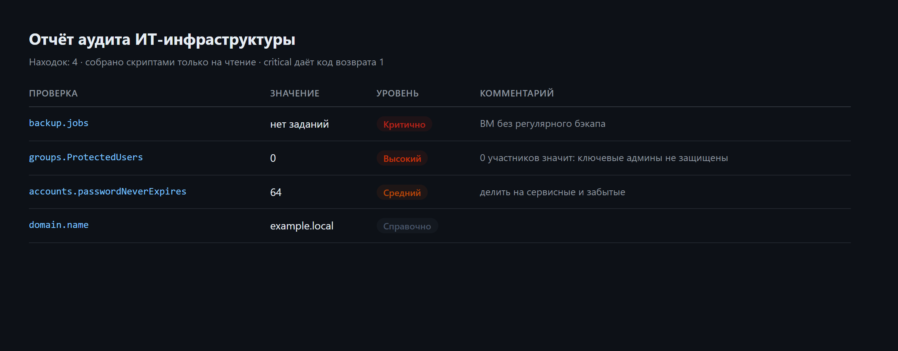

# Аудит ИТ-инфраструктуры: AD, гипервизор, бэкапы

[](https://github.com/eightpaws/it-infra-audit-kit/actions/workflows/ci.yml)

Набор скриптов, которые снимают состояние домена, виртуальных машин и резервного копирования и складывают это в отчёт с оценкой риска. Только чтение: ни одна проверка ничего не меняет.

Сделано под реальную эксплуатацию: Windows и Linux, домен на Windows Server, гипервизор Proxmox VE, бэкапы через vzdump и Windows Server Backup. Проверки собраны не из статей, а из рабочих грабель, каждая описана в `docs/pitfalls.md`.

## Зачем это

Аудит обычно делают раз в год и получают PDF на сорок страниц, который никто не читает. Здесь другой подход: запускается за минуту, даёт одну таблицу «что чинить первым», и его можно прогонять хоть каждую неделю, чтобы видеть динамику.

Три вопроса, на которые отвечает отчёт:

| Вопрос | Какие проверки отвечают |
|---|---|
| Домен в порядке? | репликация, роли FSMO, состав привилегированных групп, Protected Users, krbtgt, LAPS, гигиена учёток |
| Виртуалки защищены? | задания vzdump, отключённые задания, последний прогон, свободное место в хранилищах, кворум кластера |
| Копии восстанавливаются? | версии WSB и их возраст, бэкап GPO, VSS-писатели, пароль DSRM, журнал прогонов восстановления |

## Быстрый старт

Windows, домен:

```powershell
.\windows\Invoke-AdAudit.ps1 -OutFile out\ad-audit.jsonl
.\windows\Invoke-BackupAudit.ps1 -OutFile out\backup-audit.jsonl -GpoBackupPath D:\GPOBackup
```

Linux, гипервизор и копии:

```bash
./linux/audit-pve.sh out/pve-audit.jsonl
./linux/audit-backups.sh out/backup-audit.jsonl
```

Отчёт из любых сочетаний файлов:

```bash
python3 tools/render.py out/*.jsonl -o out/report.md
```

Код возврата `render.py` равен 1, если есть критичные находки: удобно для мониторинга и CI.

## Как выглядит результат



```
отчёт: out/report.md (5 находок, критичных: 0)
```

```markdown
## Итог

| Уровень | Сколько |
|---|---|
| Средний | 2 |
| Низкий | 1 |
| Справочно | 2 |

## Что чинить первым

- **gpo.backup**: каталог не найден: D:\GPOBackup. Путь передаётся параметром -GpoBackupPath
- **dsrm.passwordSaved**: не подтверждено. Без пароля DSRM восстановление контроллера упирается в сейф
```

Это реальный вывод с машины, где бэкап ещё не настроен: скрипт честно говорит «не подтверждено», а не «всё хорошо».

## Что проверяется

Windows, домен (`windows/Invoke-AdAudit.ps1`):

- домен и лес, режим леса, PDC Emulator, число контроллеров и глобальных каталогов;
- роли FSMO через `netdom query fsmo`;
- репликация через `repadmin /replsummary`;
- состав Domain Admins, Enterprise Admins, Schema Admins, Protected Users;
- объекты с `adminCount=1`, пароли без срока действия, неактивные учётные записи и компьютеры;
- покрытие LAPS, возраст пароля krbtgt;
- GPO: количество, недавние изменения, частично отключённые;
- `MachineAccountQuota`, AD-интегрированные зоны DNS.

Windows, копии (`windows/Invoke-BackupAudit.ps1`):

- версии Windows Server Backup и возраст последней;
- свежесть каталога `Backup-GPO`;
- состояние VSS-писателей;
- сохранён ли пароль DSRM.

Linux, гипервизор (`linux/audit-pve.sh`):

- версия PVE, кворум кластера;
- задания `vzdump`: есть ли, не отключены ли, не стоит ли режим suspend;
- последний прогон: строка `Finished Backup` и возраст лога;
- заполнение хранилищ, репликация, возраст `config.db`.

Linux, копии (`linux/audit-backups.sh`):

- таймеры и каталоги копий, их свежесть;
- наличие дампов баз;
- журнал проверок восстановления.

## Границы

Честно о том, чего здесь нет:

- скрипты не исправляют ничего и не требуют записи в инфраструктуру;
- нет инвентаризации железа и лицензий: это отдельная задача, здесь только состояние домена, виртуалок и копий;
- проверки AD требуют модуля `ActiveDirectory`, часть команд ( `repadmin`, `dcdiag`, `vssadmin` ) требует прав администратора и без них вернёт пустоту, скрипт это помечает;
- оценка риска экспертная: severity расставлена по логике «что может привести к остановке или утечке», а не по формальному стандарту.

## Что нужно доработать под себя

- пути к каталогам копий (`-GpoBackupPath`, каталоги в `audit-backups.sh`);
- порог неактивности (`-InactiveDays`, по умолчанию 90);
- порог свежести копий (`-MaxAgeHours`, по умолчанию 48);
- если бэкап идёт через Veeam или PBS, добавить соответствующие проверки: структура отчёта это позволяет, нужен только новый скрипт, который пишет такие же JSONL-строки.

## Лицензия

MIT. Автор: Антон Коровин, [korovin.info](https://korovin.info).
